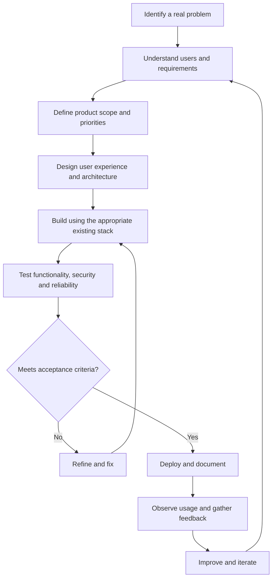

# CSEdge

### Engineering products. Building systems. Solving real problems.

**CSEdge** is a product engineering and technology company building software products, SaaS platforms, AI-powered applications, developer tools, and digital solutions for businesses and educational institutions.

We work across the product lifecycle — from identifying real problems and designing workflows to engineering, deployment, and continuous improvement.

Our focus is simple: **build useful software, simplify complex workflows, and turn ideas into products people can actually use.**

---

## What We Do

<table>
<tr>
<td width="50%" valign="top">

###  AI & Machine Learning

- AI-powered applications
- Intelligent assessment and recommendation systems
- Generative AI integrations
- Skill-gap analysis
- Data-driven decision support
- Workflow automation

</td>
<td width="50%" valign="top">

###  Education Technology

- Learning management systems
- Online examination platforms
- Coding and technical assessments
- AI-assisted evaluation
- Interview preparation
- Student performance and placement systems

</td>
</tr>
<tr>
<td width="50%" valign="top">

###  SaaS & Business Platforms

- Multi-tenant SaaS applications
- Billing and business workflows
- Property and PG management
- ERP and CRM solutions
- Administrative dashboards
- Business process automation

</td>
<td width="50%" valign="top">

###  Developer Tools

- Visual Studio Code extensions
- Developer productivity utilities
- Environment diagnostics
- Port and process management
- Markdown preview
- SEO and metadata analysis tools

</td>
</tr>
</table>

---

## Our Products & Platforms

###  JusPrep

**Learning, assessment, and career-readiness platform**

JusPrep brings learning, assessment, institutional operations, and career preparation into a connected platform.

- Course and content delivery
- Question banks and online examinations
- Coding assessments and hidden test cases
- AI-assisted proctoring
- Speaking and communication assessments
- AI mock interviews
- Attendance and timetable management
- Placement tracking and skill assessment
- Certificates and verification
- Institutional administration and reporting

Our product direction focuses on flexibility: institutions should be able to use individual assessment capabilities without being required to adopt the entire LMS.

###  HiPG

**PG and co-living management SaaS**

HiPG focuses on simplifying the day-to-day operations of independent paying guest accommodations and co-living properties.

- Property, room, and bed inventory
- Tenant profiles and allocation
- Rent generation and payment tracking
- Automated reminders
- Property storefronts and lead management
- Tenant onboarding and records
- Owner dashboards and configurable settings

###  Nexus

**CSEdge operations and partner ecosystem**

Nexus is part of our connected platform ecosystem, supporting operational workflows and partner-related initiatives.

- Partner network
- Connected operational experiences
- Centralised platform workflows

[Explore the CSEdge Partner Network](https://nexus.csedge.co/partner-network)

###  MAAS

**Technology platform**

A platform initiative within the CSEdge ecosystem. Visit the platform for its current capabilities and product information.

###  Pulse

**Connected workflows and platform initiatives**

An initiative within our broader product ecosystem. See the platform for its current scope and available features.

###  Foundry

**Product engineering and building initiatives**

Foundry is part of our wider product ecosystem, supporting our focus on engineering and building useful technology products.

---

## Developer Extensions

We build focused Visual Studio Code extensions that help developers manage everyday workflows with less friction.

<table>
<tr>
<td width="50%" valign="top">

###  CSEdge Port Manager

Find and manage processes occupying local development ports.

[View on Marketplace](https://marketplace.visualstudio.com/items?itemName=csedge.csedge-port-manager)

</td>
<td width="50%" valign="top">

###  MetaLens SEO

SEO and metadata inspection tools within the development workflow.

[View on Marketplace](https://marketplace.visualstudio.com/items?itemName=CSEdge.metalens-seo)

</td>
</tr>
<tr>
<td width="50%" valign="top">

###  SwiftMark Preview

A Markdown preview utility for a smoother writing and documentation workflow.

[View on Marketplace](https://marketplace.visualstudio.com/items?itemName=CSEdge.swiftmark-preview)

</td>
<td width="50%" valign="top">

###  VS Code Shortcuts Trainer

Learn and practise keyboard shortcuts to improve development productivity.

[View on Marketplace](https://marketplace.visualstudio.com/items?itemName=CSEdge.vscode-shortcuts-trainer)

</td>
</tr>
<tr>
<td width="50%" valign="top">

###  Environment Doctor

Help diagnose common development-environment and configuration issues.

[View on Marketplace](https://marketplace.visualstudio.com/items?itemName=CSEdge.environment-doctor)

</td>
<td width="50%" valign="top">

###  More Developer Tools

Explore our organisation's repositories for additional utilities, experiments, and developer-focused projects.

[Explore CSEdge on GitHub](https://github.com/csedge)

</td>
</tr>
</table>

---

## Technology Stack

We choose technologies based on product requirements, maintainability, and the problem being solved. The following logos represent technologies used across our work, not necessarily in every product.

### Languages

&nbsp;
&nbsp;
&nbsp;

### Frontend & Application Frameworks

&nbsp;
&nbsp;
&nbsp;

### Backend, Databases & Cloud

&nbsp;
&nbsp;
&nbsp;
&nbsp;
&nbsp;

### AI, Data & Engineering Tools

&nbsp;
&nbsp;
&nbsp;

SVGL provides the SVG logos used above. Technology selection varies by project and is subject to each product's requirements.

---

## How We Build

We approach product development as a continuous process rather than a one-time delivery.

Our engineering principles:

- **Problem-first:** understand the actual user need before adding features.
- **Practical architecture:** build maintainable systems with clear responsibilities.
- **Reusable engineering:** share capabilities where doing so improves consistency and reduces duplication.
- **Reliability:** consider error handling, security, testing, and recovery as part of development.
- **Purposeful AI:** use AI when it creates meaningful value.
- **Continuous improvement:** learn from real usage and evolve products accordingly.

---

## Partner With CSEdge

We welcome collaboration with developers, designers, educators, institutions, businesses, and technology partners.

Our partner network is intended to connect people and organisations interested in building, delivering, and growing technology-driven solutions.

**Interested in partnering with us?**

[Explore the CSEdge Partner Network](https://nexus.csedge.co/partner-network)

---

## Connect With Us

| Channel | Link |
|---|---|
| Website | [csedge.co](https://csedge.co/) |
| LinkedIn | [CSEdge on LinkedIn](https://www.linkedin.com/company/csedge/) |
| Email | [contact@csedge.co](mailto:contact@csedge.co) |
| GitHub | [CSEdge Organisation](https://github.com/csedge) |
| Partner Network | [nexus.csedge.co/partner-network](https://nexus.csedge.co/partner-network) |

---

  <strong>CSEdge</strong> 
  From ideas to engineered products.

